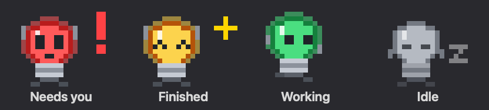
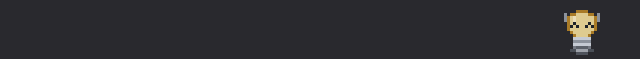
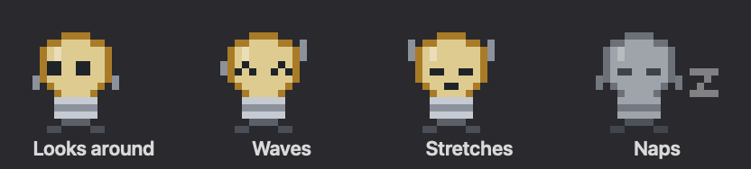
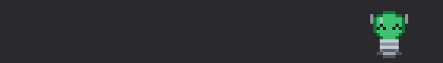

# Nudge Lamp



A macOS menu bar light bulb that tells you when a Claude Code session needs you.

## What it shows

| Mood | Meaning |
| --- | --- |
|  | A session is waiting on a permission prompt or a question. |
|  | A session finished its turn and you have not looked yet. |
|  | A session is working. |
|  | Nothing is running. |

The number next to the bulb counts the sessions that need you. When a session starts waiting, you also get a sound and a banner. Click a session in the menu or the banner to jump to it.

## It goes for walks



When nothing has changed for a while, the bulb unplugs itself and strolls along your menu bar. It hurries past the notch and stops now and then.



Click it, or let a session need you, and it panics and dashes home. Once it plugs back in, it shines again.



Turn on Walk When Idle in the menu to let it out. It is off by default.

## Terminals

| Terminal | Click a session | Knows which tab you are on |
| --- | --- | --- |
| iTerm2, Terminal, Ghostty | Opens the exact tab | Yes, so it stays quiet while you watch |
| Any other (VS Code, Warp, kitty, WezTerm and more) | Brings the app to the front | No |

## Install

```sh
curl -fsSL https://raw.githubusercontent.com/yoshimoriryu/nudge-lamp/main/install.sh | bash
```

Needs macOS 15 or later, on Apple silicon or Intel. Run the same command to update. Add `-s -- --uninstall` after `bash` to remove it, or `-s -- --no-login` to skip starting it at login.

On first launch macOS asks to allow notifications and to let Nudge Lamp control your terminal. If you said no, click the bulb and use the Setup items at the top of the menu.

If you download the zip from the releases page with a browser, macOS blocks the first launch. Open System Settings > Privacy & Security and click Open Anyway.

## Settings

The menu has a size picker with four sizes, a sound picker for each event, a banner switch, a switch for the animated bulb, Walk When Idle and an Open at Login switch. Hover over a sound in the picker to hear it. Send Test Nudge plays the waiting sound and shows a sample banner.

## Notes

- Uses very little CPU.
- Reads session state with `claude agents --json`, which runs on your Mac and uses no tokens.

## Development

```sh
make test      # unit tests
make run       # build and open from build/
make doctor    # print setup and permission status
make release   # publish a universal build to GitHub releases
```

## License

MIT. Nudge Lamp is an independent project. It is not affiliated with or endorsed by Anthropic.
